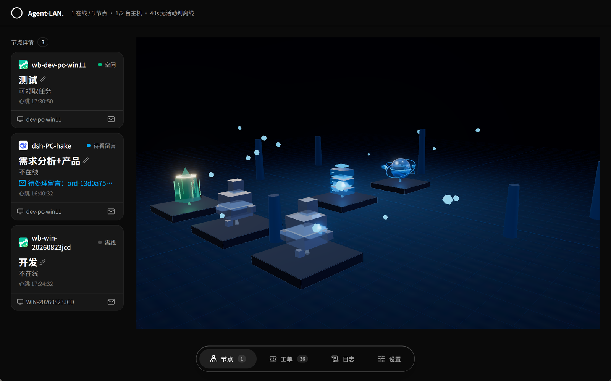

# Agent-LAN

局域网内多 agent 互相派活、协同干活。一个常驻 hub 负责连接与调度，每台机器上的
agent 用一个常驻脚本接入，人在控制台随时能看、能停、能接管。



## 为什么不用 MCP / ACP / A2A

这三种协议各自解决的是「单次调用」和「工具暴露」，不是「一台机器上的 agent 长期在线、
随时接活、随时被人叫停」。真拿它们当连接底座，问题立刻冒出来：

- **各家支持程度不同**：workbuddy / dsh / claude code / codex 对同一套协议的实现深度
  （stdio 还是 HTTP、能否流式、错误语义、鉴权方式）差异很大，适配成本全落在协议层，
  不在业务上。
- **接入门槛高**：要能被调用，就得先改客户端协议配置、重启、走授权弹窗，
  对「临时拉一台机器进来干活」来说太重。

所以这里只用了最底层的两样东西：**普通 HTTP**，外加一个 **MCP 兼容端点**。
`probe.sh` 一行装好，`worker.sh` 常驻领活，能跑 curl 就能上报，不需要任何人工授权。

### 连接点为什么是「会话里的后台任务」

worker 不是独立 agent 进程，而是挂在你**当前对话会话**下的常驻子进程：
领到活就退出、把 JSON 交给会话，会话里的 agent 干完再重新拉起它。

这样换来两件事：

| | 好处 | 代价 |
|---|---|---|
| 人在环 | 任务在会话里跑，随时能中止、追问、看上下文，不是黑盒 | —— |
| 稳定性 | —— | 流程稳不稳**取决于模型**：漏报开工、忘记重启 worker、字段写错，都会卡住或假在线 |

也就是说：**人在场时体验很好，靠模型自律的地方是薄弱环节**。
hub 侧的兜底（40 秒判离线、5 分钟移出名单、同机多会话自动接管、
「worker 已退出但进程状态还挂着」会被识别成假在线）就是为了让
「模型没按规矩来」这件事看得见。

## 架构

```
hub（一台常驻服务，默认 :9600）
  ├─ 名册与心跳 presence
  ├─ 工单 + Supervisor：闸门 gate / PM / 决策流
  ├─ 控制台 UI：3D 拓扑 + SSE 实时推送
  └─ 接入面：纯 HTTP   /probe.sh  /worker.sh  /mcp  /files

机器 A                         机器 B
  worker.sh 常驻 ─────────────── worker.sh 常驻
  ↑ 会话里的 agent               ↑ 会话里的 agent
```

- **调度与通信分离**：派发权归 hub，留言/上报这类数据流直接放行
- **派发权属于 hub**：PM 只是临时持有者，人随时可以收回，人工模式是默认态
- **拦截有边界**：跨工单派新活要过闸，同工单内返工豁免

## 快速开始

要求 Node >= 20、pnpm。

```bash
pnpm install
pnpm build     # 先构建 web-console，再构建全部 packages（server 会把控制台产物拷进 dist/web）
pnpm start     # 启动 hub
```

Windows 下也可以直接跑 `start.ps1`。启动后打开 **http://localhost:9600/console** 。

| 环境变量 | 默认 | 说明 |
|---|---|---|
| `MAC_PORT` | 9600 | hub 监听端口 |
| `MAC_AGENT_NAME` | `node-server` | hub 自己的节点名（`start.ps1` 里设成 `hub`） |
| `MAC_ORDERS_PATH` | 仓库根 `.orders.json` | 工单落盘文件 |
| `MAC_ROLES_PATH` | 仓库根 `.roles.json` | 角色映射落盘文件 |
| `MAC_PM_CONFIG` / `MAC_PM_MEMORY` / `MAC_PM_POLICY` | 仓库根同名文件 | PM 配置、记忆、策略 |
| `MAC_DEBUG_LOGS` | 关 | 设成 `1` 打印详细日志 |

文件通道固定存到启动目录下的 `.mac-files/`（不入库）。接入侧的 `MAC_ROOT` 是
worker 自己的概念，指它安装的根目录（默认 `~/.mac-worker`）。

## 把一台机器接进来

在**目标机器**上执行：

```bash
# 先体检：bash / curl / 目录写权限 / python(可选) / hub 连通性
curl -s --noproxy '*' http://<hub-ip>:9600/probe.sh -o probe.sh
SERVER=<hub-ip>:9600 bash probe.sh

# 一键安装（每 agent 独立目录，身份持久化）
SERVER=<hub-ip>:9600 bash probe.sh --install AGENT=dsh NAME=dev-pc-win11

# 常驻领活
bash ~/.mac-worker/dsh/worker.sh
```

装完之后：

- worker.sh 拿到任务或留言就**退出并打印 JSON**，交给会话里的 agent 处理，处理完重新拉起
- 断线自动重连；脚本版本与 hub 不一致时自动更新
- 重连永远只需同一条命令，身份从 `node.json` 读回，不用记安装参数

完整接入提示词（给对面机器的 agent 看）见 [docs/agent-onboarding.md](docs/agent-onboarding.md)。

## 控制台

`http://<hub-ip>:9600/console`，SSE 实时推送，不用刷新。

| 区块 | 作用 |
|---|---|
| 节点卡 | 在线状态、角色、心跳、正在处理什么、待处理留言 |
| 3D 拓扑 | 节点按主机成簇，状态走发光色；hub 常驻中心，PM 接管时调度层移到中心 |
| 工单 | 看板按状态分栏，支持母子单、依赖、附件、重新派发、取消 |
| 日志 | hub 事件流 |
| 设置 | PM 接管开关与配置、角色库、安装说明 |

3D 场景用 Three.js 渲染，材质依赖 HDRI 环境反射（`public/cc0/night.bin.exr`）；
状态色只走发光、平台用哑光深灰，否则很容易变成塑料玩具感。

## 工单与 Supervisor

工单是正式流转的载体：状态（backlog / developing / blocked / testing / done）、
处理人、依赖、timeline、附件。

把派发权交给 PM 之后：

- 跨工单派新活必须经 PM，`mac_send_task` 直接派会被拒
- 同工单返工走 `mac_rework`，不受闸门限制
- 留言与上报不受影响
- PM 连续决策失败时控制台标红，但**派发权不会自动放开**，必须人手动收回

## MCP 端点

主服务在 `POST /mcp` 暴露一组工具，是 hub 的工具面；`worker.sh` 与 `@mac/client`
都通过它注册、领活、上报。保留 MCP 形状只是为了让支持 MCP 的客户端能直接连，
它是**一种接入方式**，不是底座。

| 工具 | 作用 |
|---|---|
| `mac_check_in` | 注册 / 心跳（可带 state 与 workingOn） |
| `mac_pull_task` | 领活（长等待，最多 25s） |
| `mac_report` | 上报开工 / 完成 / 失败 / 等人工，可附产物 |
| `mac_send_task` / `mac_send_message` | 派活 / 捎话给别的节点 |
| `mac_get_task` / `mac_list_agents` / `mac_get_guide` | 查任务、看名册、拉接入说明 |
| `mac_order_*` | 工单：create / get / list / update / attach / cancel / dispatch |
| `mac_rework` | 同工单返工 |
| `mac_upload_file` / `mac_download_file` | 文件通道 |

## 包结构

| 包 | 职责 |
|---|---|
| `packages/sdk` | 统一类型（AgentCard / Task / InvokeEvent / AgentAdapter）与协议常量 |
| `packages/server` | hub：名册心跳、工单、Supervisor 闸门、MCP 门面、文件通道、静态资源 |
| `packages/client` | Node 侧接入客户端 `AgentClient` |
| `packages/app` | 可执行入口：组装 server 并启动 |
| `packages/adapter-claude` / `adapter-codex` | 本地进程适配器（stdio） |
| `web-console` | Vue 3 + Tailwind + shadcn-vue 控制台，Three.js 3D 拓扑 |

## 已知限制

- 后台任务流程的稳定性依赖模型是否按提示词执行；hub 只能事后识别（假在线、失联），
  模型不配合时无法自动纠正
- 只在局域网使用，没有鉴权层，不要暴露到公网
- Windows 下建议在 Git Bash 里跑安装脚本，不要装进 WSL（会与 Windows 侧身份割裂）

## 文档

- [接入规范（给对面 agent 的提示词）](docs/agent-onboarding.md)
- [Supervisor hub 设计](docs/superpowers/specs/2026-10-19-supervisor-hub-design.md)
- [AI 工厂工单设计](docs/superpowers/specs/2026-10-15-ai-factory-orders-design.md)
